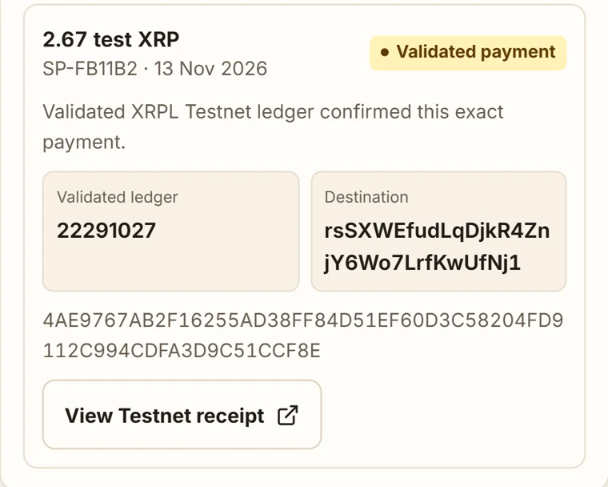
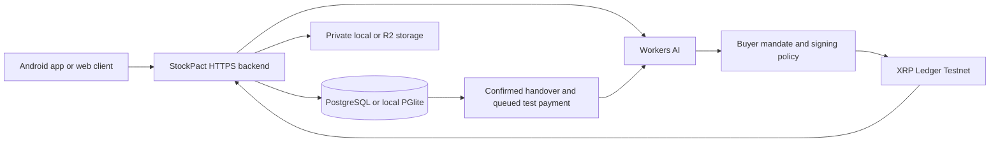

# StockPact

**A mobile procurement marketplace for buyers and suppliers across Africa, starting with a Cape Town pilot.**

StockPact gives a shop owner, caterer or purchasing team one place to find stock, ask suppliers questions, compare delivered quotes and confirm what arrived. Young suppliers and independent wholesalers can list inventory, reach nearby buyers, quote for real requests and build a reputation through completed orders. Samkelo Maswana built StockPact for the Node Engine hackathon.

[Download StockPact for Android](https://github.com/Samkelo908/stockpact/releases/download/android-demo-v0.1.5/StockPact-0.1.5.apk) · [Install on two phones](#download-and-install-on-android) · [Watch on YouTube](https://youtu.be/g6F0hIBRZw4) · [How we used Ripple’s resources](#how-we-used-the-ripple-hackathon-resources) · [Run locally](#run-locally)

## Watch the StockPact video

[](https://youtu.be/g6F0hIBRZw4)

Watch Samkelo Maswana’s StockPact Africa presentation. [StockPact Africa on YouTube](https://youtu.be/g6F0hIBRZw4)

## Download and install on Android

1. On each Android phone, sign in to GitHub with an account that can access the private StockPact repo. Open the [direct APK download](https://github.com/Samkelo908/stockpact/releases/download/android-demo-v0.1.5/StockPact-0.1.5.apk), or open the [release page](https://github.com/Samkelo908/stockpact/releases/tag/android-demo-v0.1.5), expand **Assets**, and tap **StockPact-0.1.5.apk**.
2. Open **StockPact-0.1.5.apk** from your phone’s **Downloads** and tap **Install**. Android 8.0 or later is required. If Android asks for permission, tap **Settings**, enable **Allow from this source** for the app that opened the APK, and return to the installer.
3. Launch **StockPact** from the Android launcher. Enter the access code shared privately by the workspace host. The signed APK connects to the host’s HTTPS workspace, so the workspace must be online and both phones need internet access.
4. On phone 1, stay in **Buyer · Harbour Table**. On phone 2, open the account menu and switch to **Supplier · Cape Supply Co.** Allow camera or microphone access when you choose to use those features. [Two-phone walkthrough](#two-phone-ripple-demo)

If GitHub shows **404**, check that you’re signed in to an account with repo access, or ask the workspace host to send you the signed APK. If StockPact shows **Reconnect**, sign in again and retry your action. StockPact keeps the in-progress sourcing draft during sign-in. If the workspace’s temporary HTTPS address changes, install an APK built for the new address. [Build an APK for another workspace](android/README.md)


## Why StockPact

A first-time shop owner can spend hours finding who has stock, what a case contains and how much delivery will add. A young wholesaler can have the right goods on hand and still struggle to reach customers outside an existing network. StockPact brings those decisions into a shared purchasing record that both businesses can follow from the first question through delivery.

The first market uses South African rand, Cape Town delivery areas and South African date formatting. The expansion plan is to validate the model with local buyers and suppliers, then adapt it market by market for local currencies, languages, delivery networks and payment options.

## What the app does

| Area | What you can do |
| --- | --- |
| **Purchasing assistant** | Type or speak a requirement, or use the guided form. Review the extracted product, quantity, pack size, delivery or collection area, date, budget and notes. You can edit the draft before starting the search. |
| **Supplier discovery** | Browse the marketplace and filter stock. A request search checks verified supplier listings for product fit, available stock, minimum order, unit and pack size, delivery coverage and lead time. A progress indicator shows when matching is underway and when results are ready. |
| **Requests and quotes** | Choose which suppliers receive a request for quote. Compare quantities, delivered totals, tax, delivery fees, delivery dates and quote versions. The buyer controls whether to share the budget and allow substitutions. A grouped purchase can contain up to 12 products, each with its own quotes and order. |
| **Private supplier chat** | Ask an invited supplier about stock, pack sizes, substitutions or delivery times in a conversation attached to the request. The buyer and each invited supplier have their own thread. Orders also support participant messages and private attachments. |
| **Supplier catalogue** | Create and update listings, photos, prices, minimums, quantities, delivery areas and lead times. Import catalogue rows by CSV, mark surplus stock and archive listings. Buyers can save favourites, preferred suppliers and shopping lists. |
| **Orders and delivery** | Accept a quote and reserve inventory. Use purchase approval thresholds where configured, dispatch the order and inspect full or partial deliveries. Both parties can follow the order activity and access summaries and receipts. |
| **QR handover** | The buyer generates a short-lived, single-use QR for the inspected quantity. The supplier or an eligible assigned driver scans it in StockPact, reviews the handover and confirms it. A link or token can be entered manually if the camera is unavailable. |
| **Supplier ratings** | An eligible buyer can leave one review per completed purchase with accepted goods. Rate overall experience, product quality, delivery reliability, order accuracy and communication. Suppliers can reply, users can report reviews and platform reviewers can moderate them. |
| **Business controls** | Company owners can manage staff access and verification. The reviewer workspace includes verification, disputes and reported reviews. Optional Persona Hosted Flow and account email delivery extend business onboarding. |

| Private supplier chat | Validated XRPL Testnet receipt |
| --- | --- |
|  |  |

### A purchase from start to finish

1. **Describe the order.** On Home, enter a requirement such as `I need 20 cases of chopped tomatoes, 12 tins per case, delivered to Woodstock, Cape Town by next Friday.` Choose **Build request** or open the guided form. Check the exact required date, quantity and pack size before proceeding.
2. **Find suppliers.** Select **Find suppliers**, review the matches and send the request to the suppliers you choose. Buyer business and representative verification are required to send a request outside the pre-verified fictional demo.
3. **Ask questions and compare offers.** Open the private chat with a supplier, then compare the quote terms. Suppliers receive invitations and can send or revise a quote from **Requests & quotes**.
4. **Accept and dispatch.** Accept the quote, complete any required approval, select the available payment mode and let the supplier mark the goods dispatched.
5. **Inspect and confirm.** Record the quantity that arrived. The buyer displays the handover QR and the supplier scans it from **Deliveries**. Review the handover before confirming it.
6. **Close the loop.** Check delivery and payment statuses, download the relevant receipt, and leave a review once the purchase is eligible. Use **Buy again** to start a new request from the order.

## How we used the Ripple hackathon resources

We used two materials from the Node Engine **Agentic Finance** track on BuilderBase. The *START HERE – Agentic Finance Resources* handout (pp. 1–2) defined the CFO challenge and the MVP criteria. The *XRPL Workshop Slides* (slides 7 and 9–15) showed how to choose a test network, fund a test account, send a native XRP payment and verify the result. The wallet and spending-control examples in the workshop informed how StockPact separates the agent’s decision from payment signing. [Node Engine track](https://w3node.io/node-engine) · [Ripple workshop recording, 5 November 2026](https://us02web.zoom.us/rec/share/ysQjnz16FqdWWCu601CjZ208DW38soAxEvuafrW6D5Lyk7YWEF9lTHVv63keeLR4.7EW47O_K4g8SOZYw) · [Participant Hub](https://docs.google.com/document/d/1fWs5qM31ZCN2Ij4yIZdMWr3JjHSrohsNjg4lQXl1ABw/edit)

### Ripple’s MVP criteria in StockPact

| What Ripple asked teams to demonstrate | How StockPact implements it |
| --- | --- |
| **An autonomous transaction on XRP Ledger Testnet or Devnet** | After the buyer inspects the goods and the supplier confirms the QR handover, StockPact queues the payment automatically. The Workers AI agent checks the recorded evidence and returns a request to pay or hold. When it requests payment and the signer approves the policy checks, the backend signs and submits a native XRP Ledger Testnet payment without a separate human approval for that transfer. [Handover](src/server/orders.ts) · [AI decision](src/integrations/purchasing.ts) · [Payment job](src/server/xrpl.ts) |
| **Limits enforced outside the agent** | StockPact uses the independent-service option described in the handout. The signing path checks the confirmed handover, verified parties, the configured supplier and payout address, the amount, and the mandate’s per-payment and total caps. It counts both spent and reserved XRP against the total so simultaneous payments cannot use the same remaining allowance. The model receives only the handover facts needed for its decision. The signing key and enforcement logic stay on the server. [Policy checks](src/server/xrpl-policy.ts) · [Payment reservation](src/server/xrpl.ts) |
| **Human control over the limits** | The buyer company owner approves a supplier mandate in **Company settings → XRPL Testnet autopay**. The owner can edit the caps or pause and resume the mandate. Pausing blocks new authorizations. The job keeps checking any transaction already authorized for submission. [Mandate controls](src/components/xrpl-autopay.tsx) |
| **A blocked case and an audit trail** | In the recorded run, the first handover paid **2.67 test XRP**. The second handover asked for **1.78 test XRP** with **1.33 test XRP** left under the mandate. The second payment was blocked before signing. The order shows both delivery and payment statuses and the policy reason. The audit log records the agent decision, signing authorization and settlement outcome. [Recorded Testnet receipt](https://testnet.xrpl.org/transactions/4AE9767AB2F16255AD38FF84D51EF60D3C58204FD9112C994CDFA3D9C51CCF8E) · [Reproduce the demo](docs/ripple-demo.md) |
| **A specific customer and a path to adoption** | The first customer is a small shop or food business that buys repeatedly from local wholesalers. The pilot would bring Cape Town buyers and suppliers into one workspace for quotes, delivery and payment records, then measure whether they complete orders and come back. [Pilot and business model](#business-model-and-next-milestones) |

### Workshop guidance applied to the ledger integration

1. **Choose native XRPL Testnet and fund test accounts.** The workshop explains the test networks and faucet. We used separate faucet-funded Testnet accounts for the server signer and supplier recipient. The signer checks that the node reports Testnet and a recent validated ledger. [XRPL network guide](https://xrpl.org/docs/concepts/networks-and-servers/parallel-networks) · [Official Testnet faucet](https://xrpl.org/resources/dev-tools/xrp-faucets)
2. **Build and sign a native `Payment`.** The workshop example supplies the transaction pattern. StockPact uses the `xrpl` JavaScript SDK to load the server-side test wallet and sign a payment for an exact number of drops. The adapter sets the verified destination, bounded fee, account sequence and `LastLedgerSequence`. It uses HTTPS JSON-RPC to submit and look up transactions. [xrpl.js documentation](https://js.xrpl.org/) · [StockPact XRPL adapter](src/integrations/xrpl/server.ts)
3. **Save the signed transaction before submission.** The job persists the signed data and its hash before broadcasting. If the response is interrupted, it can reconcile or resubmit the same signed transaction. A used handover cannot create another payment intent. [Reliable transaction submission](https://xrpl.org/docs/concepts/transactions/reliable-transaction-submission) · [StockPact payment job](src/server/xrpl.ts)
4. **Verify the receipt and show it in the order.** The adapter checks the transaction hash, validated ledger, destination, delivered amount and `tesSUCCESS` before recording the payment as confirmed. The order shows the hash and an explorer link so a judge can check the result independently. [Recorded Testnet receipt](https://testnet.xrpl.org/transactions/4AE9767AB2F16255AD38FF84D51EF60D3C58204FD9112C994CDFA3D9C51CCF8E)

The [XRPL AI Starter Kit](https://xrpl.org/docs/agents/agentic-transactions) informed the trigger, decision, transaction and logging flow. The workshop also presented Privy, Open Wallet Standard, t54, x402, MPP, the XRPL Docs MCP server and RLUSD as options. This submission’s payment path uses **native test XRP**, a dedicated server-side Testnet wallet, StockPact’s own policy checks and Cloudflare Workers AI. The optional EVM escrow in this repo is a separate app feature. The [Ripple setup guide](docs/ripple-demo.md) covers the native Testnet path.

## Two-phone Ripple demo

Use the account menu to keep **Phone 1** in **Buyer · Harbour Table** and switch **Phone 2** to **Supplier · Cape Supply Co.** These are fictional businesses.

1. On the buyer phone, go to **More → Company settings → XRPL Testnet autopay → New supplier mandate**. Choose Cape Supply Co., keep the configured payout address, and approve caps of **3 test XRP per payment** and **4 test XRP total**.
2. Accept Cape Supply Co.’s seeded quote for **20 cases of chopped tomatoes**. Approve the order if prompted, then choose **Choose payment method → Enable test autopay**. On the supplier phone, dispatch that order.
3. The buyer inspects **12 cases** and displays the handover QR. The supplier opens **Deliveries**, scans the code and chooses **Accept handover and check autopay**.
4. Wait for validation and open the receipt. The test payment is **2.67 test XRP**. Repeat with the remaining **8 cases**. The second payment request for **1.78 test XRP** exceeds the **1.33 test XRP** still available under the total cap. StockPact records the delivery and shows the blocked payment and its reason.
5. Show the buyer’s **Pause** control. It prevents new payment submissions from being authorized. StockPact continues checking the original hash of a transaction already authorized for submission.

| Handover | Accepted | Test payment | Outcome |
| --- | ---: | ---: | --- |
| First delivery | 12 cases | 2.67 test XRP | Validated on ledger **22291027** in the recorded run |
| Second delivery | 8 cases | 1.78 test XRP requested | Blocked by the remaining mandate cap |

[Recorded XRP Ledger Testnet transaction](https://testnet.xrpl.org/transactions/4AE9767AB2F16255AD38FF84D51EF60D3C58204FD9112C994CDFA3D9C51CCF8E) · [Detailed Ripple setup and walkthrough](docs/ripple-demo.md)

The fixed demo conversion uses R1,000 in quote value for 1 test XRP. XRP Ledger Testnet uses valueless test funds. The documented run used two mobile browser sessions and the app’s QR decoder with a test camera feed. Android sign-in and AI drafting were also checked in the installed APK on an emulator.

### Payment modes

| Mode | What settles | How to use it |
| --- | --- | --- |
| **Simulated reserve and release** | Database entries representing fictional funds | Available in the local demo without wallet or blockchain credentials. |
| **XRP Ledger Testnet autopay** | Native test XRP sent by the server’s configured test signing account | The hackathon path. Enable the Workers AI decision provider and the XRP Ledger Testnet configuration, then approve a buyer mandate. A wallet app on the phones is unnecessary. |
| **EVM testnet escrow** | A valueless ERC-20 test token funded and released through the configured contract | Optional wallet-based path. Deploy the Solidity contracts and link buyer and supplier wallets in a compatible browser. [Contract setup and limits](contracts/README.md) |

## How it works



- **App and authentication.** Next.js App Router, React, TypeScript and Tailwind CSS serve the responsive interface and API. Better Auth manages business sessions. The server checks role, company membership and access to each request or order before processing an action.
- **Data and jobs.** Kysely runs queries against PostgreSQL, or file-backed PGlite for a single local demo process. SQL migrations run on the first database connection. Transactions protect inventory reservations and settlement records. Persisted jobs handle matching, payment reconciliation, request expiry and shopping reminders.
- **AI and matching.** Cloudflare Workers AI extracts a structured draft and can transcribe short recordings. The server validates AI output. Drafting falls back to a local parser if inference is unavailable. Matching uses the stored catalogue, and buyers explicitly send requests and accept quotes. [Workers AI REST API](https://developers.cloudflare.com/workers-ai/get-started/rest-api/)
- **Handover and payment.** A QR identifies a specific order and accepted quantity. The server checks the participants, expiry and prior redemption. For native XRPL Testnet, the AI can request a payment or hold it. The signer independently checks the supplier, destination, evidence, caps and pause state. It saves the signed transaction and hash before submission, checks the original hash during recovery and marks the payment confirmed only after matching validated success. Delivery has its own status. [XRPL reliable transaction submission](https://xrpl.org/docs/concepts/transactions/reliable-transaction-submission)
- **Files and recovery.** Private files pass through authorized application routes. The service worker caches built-in marketplace and Home photos for navigation. Workspace records come from the authenticated backend, and supplier search retries reuse a request ID to avoid creating duplicate requests.

## Run locally

Use **Node.js 22.18 or later** and npm. Run these commands from the repository root.

```sh
npm ci
npm run dev
```

Open [http://localhost:3000](http://localhost:3000). Development starts with fictional demo data by default. Switch between the buyer, two suppliers, a driver and the reviewer from the account menu. A fresh local demo starts with example listings, quotes and orders. Its data persists in `.stockpact/db` by default.

To run a production build of the fictional workspace, copy [`.env.example`](.env.example) to `.env.local`. Keep `STOCKPACT_DEMO=true` and `STOCKPACT_ESCROW_MODE=demo` for simulated settlement and run the following commands.

```sh
npm run build
npm start
```

To refresh an expired seeded quote before rehearsing, stop the local app, confirm `STOCKPACT_DEMO=true` and leave `DATABASE_URL` empty. Run `npm run demo:reset` and restart. This replaces the fictional demo records.

## Configure a private workspace

For a business pilot, use a separate PostgreSQL database and a stable HTTPS origin. Set `STOCKPACT_DEMO=false`, `STOCKPACT_ESCROW_MODE=disabled` and `STOCKPACT_XRPL_ENABLED=false` to start with procurement. Set `BETTER_AUTH_URL` to the external HTTPS origin. Deploy the Node app behind the intended HTTPS endpoint and build the APK for that origin.

| Service | Environment and operation |
| --- | --- |
| **PostgreSQL and sign-in** | Set `DATABASE_URL`, `BETTER_AUTH_URL` and a unique `BETTER_AUTH_SECRET` of at least 32 characters. The database role needs permission to apply the repository’s migrations. |
| **Cloudflare Workers AI** | Set `CLOUDFLARE_ACCOUNT_ID` and `CLOUDFLARE_API_TOKEN` on the server. The environment example lists the draft, transcription and test payment decision models. |
| **Private attachments** | Set `STOCKPACT_STORAGE_MODE=local` and `STOCKPACT_FILE_PATH` for one instance with persistent disk, or configure the `STOCKPACT_R2_*` settings for a private R2 bucket. |
| **Background processing** | Schedule `POST /api/jobs` against the backend with `Authorization: Bearer <STOCKPACT_JOBS_SECRET>`. Keep the scheduler available for payment reconciliation when the phones are closed. |
| **Account email** | Configure `STOCKPACT_EMAIL_WEBHOOK` and optionally `STOCKPACT_EMAIL_SECRET`. The webhook receives email verification and password reset links for delivery to the account address. |
| **Company verification** | Use the manual reviewer workflow, or configure the optional Persona templates, API key and signed webhook. Platform reviewers grant verification after matching provider evidence to the company record. |
| **Private APK demo access** | The shared-code gateway is for the fictional demo. Run it in front of the loopback app, and give both test phones the code privately. See [Android gateway setup](android/README.md#host-a-private-demo). |

The planned Firebase deployment uses a **Cloud SQL for PostgreSQL** instance associated with Firebase SQL Connect. StockPact would connect from the Node backend via `DATABASE_URL` and keep its SQL migrations and access checks. The checked-in app currently uses PostgreSQL or PGlite. Provisioning, data migration and verification for the Firebase-backed pilot are pending. [Pilot setup](docs/pilot-setup.md) · [Firebase SQL Connect database access](https://firebase.google.com/docs/sql-connect/manage-services-and-databases#grant-postgresql-roles)

Keep runtime secrets, APK signing keys, database files, private attachments and the demo access code outside Git. For a manual verification pilot, grant the platform reviewer role to an existing authorized account with `npm run reviewer:grant -- reviewer@example.com`.

## Repository and checks

| Path | What it contains |
| --- | --- |
| [`src/app/`](src/app) and [`src/components/`](src/components) | Next.js routes, API handlers and buyer, supplier, payments and administration screens |
| [`src/server/`](src/server) | Authentication scope, procurement, reviews, handovers, payment policy and background jobs |
| [`src/integrations/`](src/integrations) | Workers AI, private storage, Persona, XRP Ledger and EVM adapters |
| [`db/migrations/`](db/migrations) | Versioned PostgreSQL schema |
| [`android/`](android) | Android wrapper, signed APK build script and private demo gateway |
| [`contracts/`](contracts) | Optional EVM escrow and test token, deployment instructions and tests |
| [`tests/`](tests) | Unit and integration tests, with Playwright scenarios in `tests/ui/` |

```sh
npm run lint
npm run typecheck
npm test
npm run build
npm run test:ui
npm run contract:build
npm run contract:test
```

Playwright runs desktop and phone viewport projects. It uses Microsoft Edge by default on Windows and Chromium on other hosts. To use Playwright Chromium, run `npx playwright install chromium` and set `STOCKPACT_BROWSER_CHANNEL=chromium`. Solidity tests run on a local test chain.

## Business model and next milestones

**Proposed revenue.** A small fee on completed orders aligns revenue with purchases that go through. Optional paid supplier plans could add catalogue management and sales reporting. The Cape Town pilot would test adoption and willingness to pay before setting prices.

**What investment would fund.** Recruit local shops and young suppliers, help them complete their first orders, and run a supported pilot on stable hosting. Track completed orders, repeat buying, supplier participation, willingness to pay and cost per order. Use those results to decide how to expand into the next African market.

**Pilot scope.** The repo includes the procurement workflow, Android app, real Workers AI calls in the configured demo and a verified native Testnet payment. Production work includes hosted database and identity onboarding, operations and reconciliation, and the controls and payment integrations required before handling real customer funds. [Implementation checklist](docs/implementation.md) · [Node Engine hackathon](https://w3node.io/node-engine)
